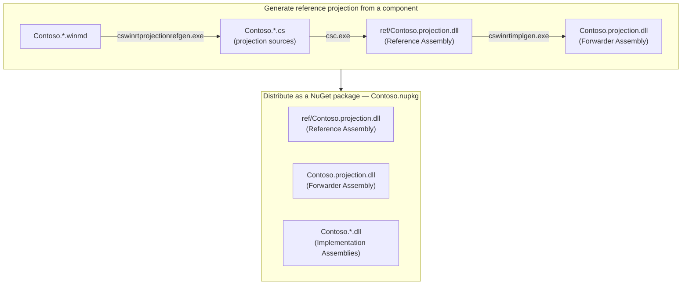
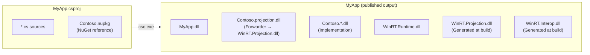

# Usage Guide

The [C#/WinRT NuGet package](https://www.nuget.org/packages/Microsoft.Windows.CsWinRT/) provides tooling for the following scenarios:

- [Generate and distribute a projection](#generate-and-distribute-a-projection)
- [Author and consume a C#/WinRT component](#author-and-consume-a-cwinrt-component) (coming soon for 3.0)

For more information on using the NuGet package, refer to the [NuGet documentation](../nuget/readme.md). Command line options can be displayed by running `cswinrtprojectionrefgen -h`.

## Getting started with CsWinRT 3.0

CsWinRT 3.0 requires **.NET 10** or later and is supported with the new `.1` **Target framework revision number**.  To opt-in to using the CsWinRT 3.0, you would need to update your target framework as below.  You may choose to multi-target to support both CsWinRT 3.0 and CsWinRT 2.x.

```xml
<!-- CsWinRT 3.0 -->
<TargetFramework>net10.0-windows10.0.22621.1</TargetFramework>

<!-- CsWinRT 2.x -->
<TargetFramework>net10.0-windows10.0.22621.0</TargetFramework>
```

## Generate and distribute a projection

Component authors need to build a C#/WinRT projection for .NET Core consumers. The C#/WinRT NuGet package (Microsoft.Windows.CsWinRT) includes the tooling which processes the .winmd files and generates a reference projection assembly under the `ref` subfolder to represent the API surface along with a forwarder assembly. These can then be distributed for .NET Core applications (.NET 10+) to reference.

For an example of generating and distributing a projection as a NuGet package, see the [projection sample](https://github.com/microsoft/CsWinRT/tree/master/src/Samples/NetProjectionSample). Note that this sample hasn't been updated yet and will be updated once the package is released on NuGet.

### Generating a reference projection

Component authors create a projection project, which is a C# library project that references the C#/WinRT NuGet package and the project-specific `.winmd` files you want to project, whether through a NuGet package reference, project reference, or direct file reference.

Here is an example project file for a projection project that generates a reference projection for types in the "Contoso" namespace:

```xml
<Project Sdk="Microsoft.NET.Sdk">

  <PropertyGroup>
    <TargetFramework>net10.0-windows10.0.22621.1</TargetFramework>
    <CsWinRTGenerateReferenceProjection>true</CsWinRTGenerateReferenceProjection>
    <CsWinRTIncludes>Contoso</CsWinRTIncludes>

    <!-- Needed until the Windows SDK projection package with CsWinRT 3.0 support is available in the .NET SDK. -->
    <WindowsSdkPackageVersion>10.0.22621.85-preview</WindowsSdkPackageVersion>
  </PropertyGroup>

  <ItemGroup>
    <PackageReference Include="Microsoft.Windows.CsWinRT" Version="3.0.0-preview.260319.2" />
  </ItemGroup>

  <ItemGroup>
    <ProjectReference Include="..\Contoso\Contoso.vcxproj" />
  </ItemGroup>

</Project>
```

By default, the **Windows** and **Microsoft** namespaces are not projected. The `CsWinRTGenerateReferenceProjection` property indicates this library is a projection project and configures it to generate a reference projection. For a full list of C#/WinRT NuGet project properties, refer to the [NuGet documentation](../nuget/readme.md).

In the example diagram below, the projection project invokes **cswinrtprojectionrefgen.exe** at build time, which processes `.winmd` files in the "Contoso" namespace to generate projection source files and compiles these into a reference projection assembly named `Contoso.projection.dll` under the `ref` subfolder along with a forwarder assembly with the same name. The reference and forwarder assembly is typically distributed along with the implementation assemblies (`Contoso.*.dll`) as a NuGet package.



### Projecting standalone exclusive interfaces

A reference projection can expose selected `[ExclusiveTo]` interfaces without also projecting their owning runtime classes. For example, a supplemental UWP XAML projection can expose an interface from the Windows SDK while its owner remains in `WinRT.Sdk.Xaml.Projection.dll`:

```xml
<PropertyGroup>
  <UseUwp>true</UseUwp>
  <UseUwpTools>false</UseUwpTools>
  <CsWinRTGenerateReferenceProjection>true</CsWinRTGenerateReferenceProjection>
  <CsWinRTIncludes>Windows.UI.Xaml.IFrameworkElementProtected7</CsWinRTIncludes>
  <CsWinRTPublicExclusiveToInterfaces>true</CsWinRTPublicExclusiveToInterfaces>
  <CsWinRTDynamicallyInterfaceCastableExclusiveTo>true</CsWinRTDynamicallyInterfaceCastableExclusiveTo>
</PropertyGroup>
```

The two switches are independent. `CsWinRTPublicExclusiveToInterfaces` controls public visibility; it does **not** enable dynamic interface casting. `CsWinRTDynamicallyInterfaceCastableExclusiveTo` enables IDIC support without making an internal interface public. Both default to `false`. Public-only interfaces still have the ABI helpers and CCW implementations needed for managed implementations; disabling IDIC does not remove this infrastructure, default interfaces, or overridable interfaces.

To narrow the IDIC opt-in while keeping all projected exclusive interfaces public, set dedicated filters on the projection project:

```xml
<PropertyGroup>
  <CsWinRTPublicExclusiveToInterfaces>true</CsWinRTPublicExclusiveToInterfaces>
  <CsWinRTDynamicallyInterfaceCastableExclusiveTo>true</CsWinRTDynamicallyInterfaceCastableExclusiveTo>
  <CsWinRTDynamicallyInterfaceCastableExclusiveToIncludes>Contoso.IWidget;Contoso.Controls</CsWinRTDynamicallyInterfaceCastableExclusiveToIncludes>
  <CsWinRTDynamicallyInterfaceCastableExclusiveToExcludes>Contoso.IWidget3</CsWinRTDynamicallyInterfaceCastableExclusiveToExcludes>
</PropertyGroup>
```

**Filter rules:**

| IDIC switch | Includes | Excludes | IDIC selection |
|-------------|----------|----------|----------------|
| `false` or unset | Any | Any | None |
| `true` | Empty | Empty | All otherwise eligible exclusive interfaces |
| `true` | Empty | B | All eligible exclusives except B |
| `true` | A | Empty | Only eligible matches of A |
| `true` | A;B | B | Only eligible matches of A that do not match B |
| `true` | A specific type | Its namespace | None; exclusions always win |

Lists are semicolon-separated and use the same **case-sensitive namespace/type-name prefix matching** as projection filters, not wildcard or regular-expression syntax. For example, `Contoso.IWidget` also matches `Contoso.IWidget2`; use narrower prefixes and exclusions where necessary. Outer whitespace is trimmed, empty entries are ignored, and duplicates are removed. Invalid prefixes (such as `Contoso.*`, `Contoso..IWidget`, or embedded whitespace) produce `CSWINRTPROJECTIONGEN5022`; valid unmatched prefixes are harmless. The CLI equivalents are `--idic-exclusive-to-includes` and `--idic-exclusive-to-excludes`, with comma-separated lists in the response file.

These filters affect casting support only, not public visibility or which APIs are selected by `CsWinRTIncludes` / `CsWinRTExcludes`. Ordinary, non-exclusive interfaces are unaffected. For a native wrapper that does not statically implement an excluded interface, `is` returns `false`, `as` returns `null`, and an explicit cast throws `InvalidCastException`. Ordinary casts to interfaces already implemented by an object are unaffected. Enabled dynamic casts still require the native object to support the interface IID and the runtime's `CsWinRTEnableIDynamicInterfaceCastableSupport` switch to remain enabled.

**Reference packages and consumers:** the producer records the sorted, exact effective IDIC type names as `WindowsRuntimeReferenceAssemblyMetadataAttribute` key/value pairs, one per selected interface. This WinRT-specific attribute has the same shape as `AssemblyMetadataAttribute`: a `(string key, string? value)` constructor and read-only `Key` / `Value` properties, with repeated keys supported. The reference assembly marker `WindowsRuntimeReferenceAssemblyAttribute` is unchanged. For example, generated reference metadata can contain:

```csharp
[assembly: WindowsRuntimeReferenceAssembly]
[assembly: WindowsRuntimeReferenceAssemblyMetadata("CsWinRT.IdicExclusiveTo.v1", "Contoso.IWidget2")]
[assembly: WindowsRuntimeReferenceAssemblyMetadata("CsWinRT.IdicExclusiveTo.v1", "Contoso.IWidget3")]
```

These are generator-owned attributes, not annotations to write manually. String names preserve intent even for internal interfaces omitted by reference-assembly compilation. The metadata remains in the packed `ref/<tfm>` assembly, not the forwarder; the consumer restores exactly that selection independently of the actual public reference surface. Unknown keys are ignored, and ordinary `AssemblyMetadataAttribute` entries do not opt interfaces into IDIC. Prefixes are not reapplied to other packages. No selection entries means no exclusive-interface IDIC; **regenerate older preview projection packages that need IDIC support**. There is no public-visibility inference or consumer-side policy override.

Consumers do not need to repeat the producer's exclusive-interface options. Projected runtime type identities must be globally unique: duplicate definitions across reference projections fail with `CSWINRTPROJECTIONGEN0015`, regardless of whether their policies agree. Metadata-only attribute projections do not contribute interop type-map keys and are exempt from this check. Malformed IDIC metadata fails with `CSWINRTPROJECTIONGEN0014`.

A projection over Windows SDK metadata alone does not need to redistribute that metadata or add it to `CsWinRTInputs`: the app-time generator uses the configured Windows SDK metadata. The standalone `IFrameworkElementProtected7` example above therefore keeps its owner in `WinRT.Sdk.Xaml.Projection.dll` while preserving both public visibility and IDIC for the selected interface.

### Distributing the projection

The reference and forwarder assembly is typically distributed along with the implementation assemblies as a NuGet package for applications to reference.

- If the projection is **not** distributed as a NuGet package, an application adds references to both the component projection assembly produced above and to C#/WinRT.
- If a third party WinRT component is distributed **without** an official projection, an application may add a reference to C#/WinRT to generate its own private component projection, assuming that is the only projection for it.
- There are versioning concerns related to the above scenario, so the **preferred solution** is for the third party to publish a projection directly.

See the [projection sample](https://github.com/microsoft/CsWinRT/tree/master/src/Samples/NetProjectionSample) for an example of how to create and reference a projection NuGet package.

### Applications

Application developers on .NET 10+ can reference C#/WinRT projection assemblies by adding a reference to the projection NuGet package. This replaces any `*.winmd` references.

At **build time**, CsWinRT automatically generates additional assemblies for the application:

- **`WinRT.Projection.dll`** — contains the actual projection implementations for all WinRT types of reference projections referenced by the application.
- **`WinRT.Interop.dll`** — contains deduplicated marshalling code, native COM interface entries, and vtable implementations for the entire application. Because this is generated after all assemblies are compiled, it can analyze the full application and avoid duplicate marshalling stubs.

This means component authors don't need to update their packages when a new CsWinRT version ships — the application generates the latest optimized implementations at application build time.



## Native AOT and trimming

CsWinRT 3.0 is designed with **AOT** in mind from the start. All generated projections are fully compatible with Native AOT and IL trimming without requiring any additional configuration from the developer.

- **Trimming** is safe by default — all generated code is fully trimmable.
- **Native AOT** works out of the box — vtables, COM interface entries, and CCW (COM Callable Wrapper) data are pre-initialized at publish time and foldable into readonly data sections by the Native AOT compiler.
- **Runtime feature switches** allow opt-in/opt-out of specific features (e.g., manifest-free activation, XAML type marshalling). Disabled features are dead-code-eliminated by the trimmer, making them fully pay-for-play.

For more details, see the [AOT and trimming documentation](aot-trimming.md).

## Key MSBuild properties

Below are the most commonly used MSBuild properties. For a full list, refer to the [NuGet documentation](../nuget/readme.md).

| Property | Default | Description |
|----------|---------|-------------|
| `CsWinRTEnabled` | `true` | Master switch — enables/disables all CsWinRT processing. |
| `CsWinRTGenerateProjection` | `true` | Generate C# projection sources from `.winmd` metadata. |
| `CsWinRTGenerateReferenceProjection` | `false` | Generate reference-only projections (for NuGet distribution). |
| `CsWinRTComponent` | `false` | Enable Windows Runtime component authoring mode. |
| `CsWinRTMarshallingMode` | `minimal` | Controls which assemblies the interop generator analyzes for marshalling code (`all`, `minimal`, or `strict`). See below. |
| `CsWinRTAnalyzeNetStandardAssemblies` | `true` | Allows .NET Standard assemblies to participate in interop discovery. Set to `false` to skip them, including explicitly opted-in assemblies. |
| `CsWinRTMarshallingEnabledAssembly` | *(item)* | Explicitly include named assemblies in discovery, subject to framework exclusions and explicit opt-outs. |
| `CsWinRTMarshallingDisabledAssembly` | *(item)* | Explicitly exclude named assemblies from discovery in every mode. |
| `CsWinRTIncludes` | *(empty)* | Semicolon-separated namespaces to include in the projection. |
| `CsWinRTExcludes` | `Windows;Microsoft` | Semicolon-separated namespaces to exclude from the projection. |
| `CsWinRTMessageImportance` | `normal` | Build message verbosity (`normal` or `high`). |

### Marshalling mode

By default (`minimal`), the interop generator analyzes **every** assembly in the app to discover user-defined
(CCW) types and generic instantiations that need marshalling code — even assemblies that don't target a
Windows TFM and don't reference any CsWinRT assembly — with the exception of the .NET base class library
(BCL). This means a plain `.NET` class library (e.g. one holding MVVM viewmodels) no longer needs to target
a `-windows` TFM just so its types can be marshalled to native code, while the BCL is skipped to keep the
generated interop assembly small.

`CsWinRTMarshallingMode` controls this behavior:

| Value | Behavior |
|-------|----------|
| `all` | Analyze all assemblies, including those from the .NET base class library (BCL). |
| `minimal` (default) | Same as `all`, but skip assemblies from the .NET base class library (BCL) to reduce binary size. |
| `strict` | Only analyze assemblies referencing the Windows Runtime assembly (i.e. those targeting a Windows TFM). |

Assemblies that reference the Windows Runtime assembly are analyzed regardless of the mode unless explicitly excluded, subject to the framework exclusions below. .NET Standard libraries (including `netstandard2.0`) follow the same mode and explicit inclusion/exclusion rules as other libraries by default. Set `CsWinRTAnalyzeNetStandardAssemblies` to `false` to skip their discovery in every mode, even if listed in `CsWinRTMarshallingEnabledAssembly`. Assemblies targeting .NET Framework are not analyzed.

```xml
<PropertyGroup>
  <CsWinRTAnalyzeNetStandardAssemblies>false</CsWinRTAnalyzeNetStandardAssemblies>
</PropertyGroup>
```

Changing this property invalidates the interop generator's property-input cache. It controls assembly discovery, not whether a type referenced by another analyzed assembly can be marshalled.

Interop discovery compares signatures using the application's runtime context, following type forwarding while ignoring assembly versions. References from older libraries, portable libraries, and implementation assemblies that resolve to the same type therefore share a type-map entry, including when used in generic arguments, nested types, or arrays. Genuinely different assembly identities remain distinct. Generated helper names, ordering, and type-valued attribute serialization use resolved identities so output does not depend on which equivalent reference was discovered first.

Generic method discovery propagates call contexts through interface implementations and virtual overrides, including explicit and inherited implementations, default interface bodies, virtual delegate targets, and constrained or static-abstract calls. The generator indexes metadata relationships once for the invocation, then follows possible bodies only when an analyzed call supplies generic arguments. Matching respects declaration identity, substituted signatures, custom modifiers, and virtual slots; a `new` virtual slot is not an override, and an ordinary nonvirtual or explicit `base` call does not expand sibling overrides.

When an implementation also needs generic receiver arguments, discovery composes the interface/base context with its declaring type and joins it with actually observed constructed receiver types. Receiver contexts discovered in other analyzed modules are joined after parallel module discovery, with a bounded additional pass that preserves their original traversal depths and can discover further contexts transitively. Completed module-local joins and already expanded dispatch body contexts are not replayed at the same or a greater depth. This is conservative metadata analysis, not runtime receiver data-flow analysis: it may include more than one possible implementation. It does not synthesize arbitrary receiver instantiations for unconstrained type parameters, or discover receiver types available only through reflection or bodies skipped by the assembly policy. An explicitly observed receiver type from a skipped module can still supply arguments for an eligible base implementation; its own excluded bodies remain skipped.

Observed concrete generic receivers also supply arguments to applicable non-generic default interface bodies. For example, `Factory<long> : IFactory<long>` can inherit an implementation of a non-generic `IFactory.Create()` slot that constructs `List<IAsyncOperation<T>>`; discovery substitutes the receiver arguments even though the call has no generic method arguments. Interface ancestry and explicit `MethodImpl` mappings preserve inherited, nested, and permuted arguments. Class implementations and more-specific interface overrides or re-abstractions suppress the replaced defaults; ambiguous defaults are not selected. Initial selection includes applicable instance bodies, not unrelated private or static interface members, and applies the body assembly's marshalling policy. Descendants retain ordinary discovery semantics: a closed type exposed by a helper operand can still receive a whole-type member scan. This receiver-driven path does not require a managed call site and does not invent receiver instantiations.

Static abstract and static virtual interface calls instead use the actual closed receiver supplied by a constrained call or method-pointer load, such as `TFactory.Create()` or `TFactory.Create` inside a generic method. The same path covers static properties, event accessors, and operators. Discovery matches the declaration identity and its exact constructed interface, composes inherited or reordered receiver arguments, and selects the most-specific implementation. Static class implementations use `MethodImpl` mappings, including C# implicit implementations; a same-named static method that merely hides an inherited member does not replace that mapping. Interface overrides and re-abstractions use the same specificity rules as instance defaults. A non-generic static slot does not need a fabricated `MethodSpec`: the selected interface body is scanned with its constructed owner and no method arguments. Open constrained receivers are not inferred from unrelated type sightings, and observing a receiver alone does not invoke its static defaults.

Ordinary member discovery continues to cover class-owned static implementations and default bodies exposed by explicit declaring-interface types. Those roots remain conservative: a default body that is independently rooted by a closed `TypeSpec` or `MethodSpec` can still contribute types even when another implementation is selected at a call. For generic static calls already handled by dispatch discovery, a complete constrained-slot selection filters out unrelated or replaced candidate bodies without changing target ordinals. If bounded metadata makes selection inconclusive, that existing path retains its candidates rather than losing previously discovered support. Additional interface-owned static overrides, including bodies whose receiver closes types independently of an open method argument, run only after the earlier supplemental work finishes.

Dispatch bodies use the same [depth](diagnostics/CSWINRTINTEROPGEN0104.md) and [signature complexity](diagnostics/CSWINRTINTEROPGEN0105.md) limits as ordinary generic member discovery, but a separate [transitive instantiation allowance](diagnostics/CSWINRTINTEROPGEN0106.md). Each module enumeration first completes ordinary discovery with the existing 1024 allowance and first-visit ordering; dispatch observations and shorter-depth sightings are only recorded during this phase. An isolated supplemental enumeration then expands dispatch bodies and contexts that can recover a depth-limited path with its own 1024 allowance. All descendants of supplemental work, including ordinary callees, consume that supplemental allowance. Results are merged additively: additional dispatch scanning cannot spend primary reservations or displace signatures previously found by ordinary discovery. Generic and SZ-array enumerations retain separate per-root worklists and allowances, and the late cross-module join has its own bounded enumeration for each result kind. Possible implementations never inherit the explicit metadata root's one-hop exemption from the assembly marshalling policy.

Receiver-driven non-generic defaults are deferred until the existing supplemental queue has drained, then processed in first-observation order using its remaining allowance. Receivers discovered by those bodies are handled in subsequent batches without resetting the budget. If earlier supplemental work exhausts the allowance, default-body support may remain incomplete. Late cross-module completion likewise drains previously supported pairs and their descendants before admitting observations published by default-body discovery, using the same remaining late allowance. Importing receivers for that join does not repeat their default-body scans; new receiver contexts discovered while it runs can still contribute defaults within the late pass's allowance.

Additional constrained static calls form a final supplemental phase and use that same remaining allowance, not another 1024 reservations. Their ordinary callees, static initializers, and newly exposed instance defaults retain canonical member traversal and the static phase's provenance. Cross-module completion admits publications in generic-dispatch, instance-default, then static-dispatch order. It completes the existing join-local instance-default work before importing static publications, so later calls cannot displace those earlier contexts. Pairs involving an earlier demand and a newly published receiver, or a new demand and an earlier receiver, remain supported; module-local pairs are not retried with a fresh late budget.

Dispatch calls discovered while completing cross-module joins can also require receivers imported by a later publication phase. These late-local demands are retained and paired after the existing joins and their default/static descendants finish, using only the remaining late allowance. Descendants of the appended pairs can interleave ordinary generic calls, instance defaults, and constrained static calls; newly discovered demands and receivers join inline once all publication phases have been imported.

### Opting in specific assemblies

The `CsWinRTMarshallingEnabledAssembly` item lets you analyze specific assemblies regardless of the marshalling mode, unless explicitly excluded. This is useful for fine-tuning binary size: for example, you can keep the `strict` mode (the smallest option) while opting in just the few assemblies you know need marshalling support:

```xml
<PropertyGroup>
  <CsWinRTMarshallingMode>strict</CsWinRTMarshallingMode>
</PropertyGroup>

<ItemGroup>
  <CsWinRTMarshallingEnabledAssembly Include="MyApp.ViewModels" />
  <CsWinRTMarshallingEnabledAssembly Include="MyApp.Models" />
</ItemGroup>
```

Each item is an assembly name (the `.dll` extension is optional; paths and casing are ignored). The interop generator reports a warning if an entry doesn't match any referenced assembly (except in `all` mode, where all opt-ins are redundant), and an informational message if an entry is redundant (e.g. it already targets Windows, or the mode is `all`).

### Excluding specific assemblies

The `CsWinRTMarshallingDisabledAssembly` item skips discovery of named assemblies even if the selected mode would analyze them, they reference the Windows Runtime assembly, or they are also listed in `CsWinRTMarshallingEnabledAssembly`. This can avoid scanning a dependency with many unused generic instantiations:

```xml
<ItemGroup>
  <CsWinRTMarshallingDisabledAssembly Include="MyApp.LargeDependency" />
</ItemGroup>
```

Like opt-ins, entries match the assembly's simple name, case-insensitively (the directory and `.dll` extension are ignored). An unknown name produces a warning; if the same assembly is both enabled and disabled, the exclusion wins and a warning reports the conflict. Both warnings honor `CsWinRTGeneratorTreatWarningsAsErrors`. Changing these items invalidates the interop generator's property-input cache.

Exclusion skips the assembly's normal type and member scans, plus indirect member expansion in that assembly, including static initializers. It does **not** remove the assembly from type resolution, suppress signatures used directly by analyzed code (including explicit generic type specifications and method calls), or prevent the generator from loading required WinRT projection modules and discovering component activation factories. If excluded code requires marshalling that no analyzed code exposes, **you are responsible for ensuring the necessary interop is generated**; otherwise publishing or runtime marshalling can fail.

## Author and consume a C#/WinRT component

This is coming soon for CsWinRT 3.0.

C#/WinRT provides authoring and hosting support for C# component authors. For more details, refer to this [walkthrough](https://docs.microsoft.com/en-us/windows/uwp/csharp-winrt/create-windows-runtime-component-cswinrt) and these [authoring docs](https://github.com/microsoft/CsWinRT/blob/master/docs/authoring.md).