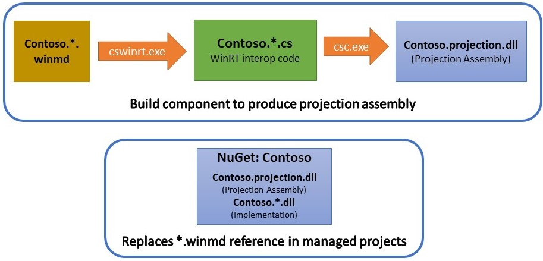
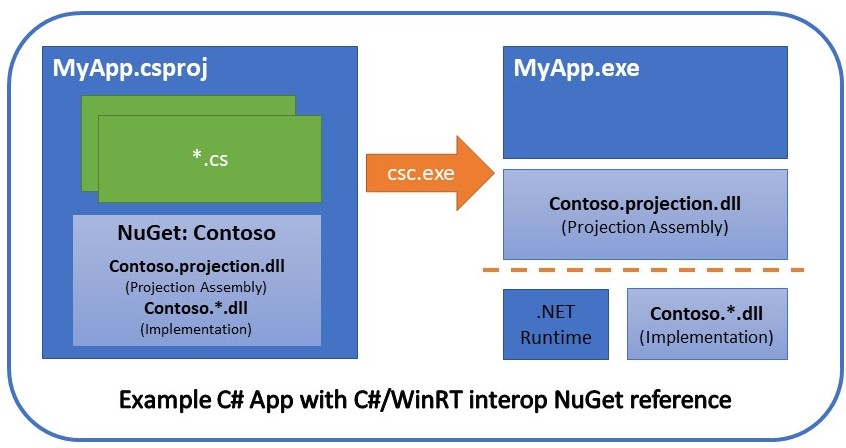

# Usage Guide

The [C#/WinRT NuGet package](https://www.nuget.org/packages/Microsoft.Windows.CsWinRT/) provides tooling for the following scenarios:

- [Generate and distribute an interop assembly](#generate-and-distribute-an-interop-assembly)
- [Embedded support for WinRT types](#embedded-support-for-winrt-types)
- [Author and consume a C#/WinRT component](#author-and-consume-a-cwinrt-component) (in preview)

For more information on using the NuGet package, refer to the [NuGet documentation](../nuget/readme.md). Command line options can be displayed by running `cswinrt -?`.

## Generate and distribute an interop assembly

Component authors need to build a C#/WinRT interop assembly for .NET 5+ consumers. The C#/WinRT NuGet package (Microsoft.Windows.CsWinRT) includes the C#/WinRT compiler, **cswinrt.exe**, which you can use to process .winmd files and generate projection source files. These source files are compiled into an interop projection assembly, and then distributed along with the C#/WinRT runtime assembly for .NET 5+ applications to reference.

For an example of generating and distributing a projection interop assembly as a NuGet package, see the [projection sample](https://github.com/microsoft/CsWinRT/tree/master/src/Samples/NetProjectionSample) and [associated walkthrough](https://docs.microsoft.com/windows/uwp/csharp-winrt/net-projection-from-cppwinrt-component).

### Generating an interop assembly

Component authors create a projection project, which is a C# library project that references the C#/WinRT NuGet package and the project-specific `.winmd` files you want to project, whether through a NuGet package reference, project reference, or direct file reference.

The following project fragment demonstrates a simple invocation of C#/WinRT to generate projection sources for types in the "Contoso" namespace. These sources are then included in the project build. By default, the **Windows** and **Microsoft** namespaces are not projected.

```xml  
<PropertyGroup>
  <CsWinRTIncludes>Contoso</CsWinRTIncludes>
</PropertyGroup>
```

For a full list of C#/WinRT NuGet project properties, refer to the [NuGet documentation](../nuget/readme.md).

In the example diagram below, the projection project invokes **cswinrt.exe** at build time, which processes `.winmd` files in the "Contoso" namespace to generate projection source files and compiles these into an interop projection assembly named `Contoso.projection.dll`. The interop assembly is typically distributed along with the implementation assemblies (`Contoso.*.dll`) as a NuGet package. 



### Distributing the interop assembly

An interop assembly is typically distributed along with the implementation assemblies as a NuGet package for applications to reference. This package will require a dependency on C#/WinRT to include `WinRT.Runtime.dll` for .NET 5+ targets. If the interop assembly is not distributed as a NuGet package, an application adds references to both the component interop assembly produced above and to C#/WinRT to include the `WinRT.Runtime.dll` assembly. If a third party WinRT component is distributed without an official interop assembly, an application may add a reference to C#/WinRT to generate its own private component interop assembly.  There are versioning concerns related to this scenario, so the preferred solution is for the third party to publish an interop assembly directly.

See the [projection sample](https://github.com/microsoft/CsWinRT/tree/master/src/Samples/NetProjectionSample) for an example of how to create and reference the interop NuGet package.

### Applications

Application developers on .NET 5+ can reference C#/WinRT interop assemblies by adding a reference to the interop NuGet package, as shown in the diagram below. This replaces any `*.winmd` references. The .NET 5+ application includes `WinRT.Runtime.dll` which handles WinRT type activation logic. 



## Debugging exceptions crossing the WinRT ABI (experimental)

This opt-in experiment notifies an attached debugger at the end of
`WinRT.ExceptionHelpers.SetErrorInfo`, after recording the managed exception's error information.
Generated ABI callbacks and runtime projection callbacks, including event add/remove accessors,
use this common path before returning the translated HRESULT.
Two application project properties select the experiment. Both default to `false`:

```xml
<PropertyGroup>
  <CsWinRTEnableAbiExceptionBreak>false</CsWinRTEnableAbiExceptionBreak>
  <CsWinRTEnableAbiExceptionRaise>false</CsWinRTEnableAbiExceptionRaise>
</PropertyGroup>
```

Set `CsWinRTEnableAbiExceptionBreak` to `true` to call `Debugger.Break()`, or set
`CsWinRTEnableAbiExceptionRaise` to `true` to call native `RaiseException`. If both are
enabled, `Debugger.Break()` takes precedence. If neither is enabled, notification is
disabled. Break mode requires `Debugger.IsAttached`; raise mode requires a Win32 debugger
detected by `IsDebuggerPresent`. The selected mode does not fall back to the other mode
when its debugger check is false.

The notification runs inside the ABI catch, not an exception filter. The debugger may still
show the original throwing frames and available locals while the catch is active. Inner
`finally` blocks in the called user code have already run, so they may have changed locals
or disposed objects; a `finally` associated with the ABI catch itself runs afterward.
Optimized or asynchronous code can further limit the available frames and locals.

Continuing returns the translated HRESULT and leaves normal error propagation in place.
Expected exceptions that cross the ABI also produce notifications; this does not predict
whether XAML will eventually handle the error. Other callers of `SetErrorInfo`, such as
activation-factory entrypoints and `ReportUnhandledError`, use the same notification path.

In raise mode, the notification is a continuable, experiment-specific
Win32 exception, **`0xE0435752`**, with the original managed HRESULT as its first parameter.
In Visual Studio, enable native debugging, then add this code under **Debug > Windows >
Exception Settings > Win32 Exceptions**, naming it **C#/WinRT ABI exception**. Enable
**Break When Thrown** to stop; clear it to continue without stopping. Inspect the original
exception in `SetErrorInfo`'s `ex` parameter and select its throwing frame in Call Stack.
The notification is handled even when the debugger passes it to the application.
The notification helper is marked `DebuggerHidden` and, on .NET 6+, `StackTraceHidden`
to keep it out of stepping and formatted managed stack traces. Raw/native stack walks
can still include the helper.

Break mode works with managed-only and mixed debugging, but is an explicit breakpoint,
not a CLR exception, and cannot be disabled through per-exception settings. Raise mode
always uses the native exception, without an automatic fallback based on debugger type
or Native AOT. Without a Win32 debugger attachment, raise mode does not notify.
Foreign SEH handling under Native AOT is experimental;
do not rely on the managed `SEHException` catch there. A notification passed back to
the application can remain unhandled and terminate the process. Every raise notification
must be continued as handled by a native debugger (for example, `gh` in CDB).
Native AOT does not report a managed debugger attachment through `Debugger.IsAttached`,
so break mode does not notify there.

The properties map to `CSWINRT_ENABLE_ABI_EXCEPTION_BREAK` and
`CSWINRT_ENABLE_ABI_EXCEPTION_RAISE` AppContext switches, respectively. In untrimmed
applications, they can also be set at startup, before the first call to `SetErrorInfo`:

```csharp
AppContext.SetSwitch("CSWINRT_ENABLE_ABI_EXCEPTION_BREAK", true);
AppContext.SetSwitch("CSWINRT_ENABLE_ABI_EXCEPTION_RAISE", false);
```

Switch values are cached on first use, following the other CsWinRT feature switches.
Use the project properties when trimming or publishing Native AOT, so the selected
paths are retained. Without an attached debugger, no notification is raised.
Existing projection binaries that call `SetErrorInfo` pick up the runtime change without
regeneration. Regenerate projections to update event accessors that previously returned
the raw exception HRESULT without setting error information.
Event accessor failures now use the same HRESULT normalization as other ABI methods;
for example, `ArgumentOutOfRangeException` becomes `E_BOUNDS` rather than `0x80131502`.
Raise mode additionally requires enabling **Break When Thrown** for the custom code
to stop in native/mixed debugging.

Other useful experiments are enabling **Break When Thrown** for the original CLR exception
type (which stops at the actual throw, before the ABI catch), and using .NET 9's
`Debugger.BreakForUserUnhandledException` with `DebuggerDisableUserUnhandledExceptionsAttribute`
to integrate with managed user-unhandled settings. The latter needs separate debugger
validation and is not used by this experiment.

## Embedded support for WinRT types

Starting with C#/WinRT version 1.4.1, support is included for embedding Windows SDK projection and runtime sources for both .NET 5+ and .NET Standard 2.0 into your library or app's output. This is useful in scenarios where usage of Windows SDK types is self-contained. Embedded support removes dependencies on WinRT.Runtime.dll and Microsoft.Windows.SDK.NET.dll which reduces the library or app output size. It also allows library developers to provide downlevel support and removes the need for multi-targeting. See the [embedded docs](https://github.com/microsoft/CsWinRT/blob/master/docs/embedded.md) for more details.

## Author and consume a C#/WinRT component

C#/WinRT provides authoring and hosting support for .NET 5 component authors. For more details, refer to this [walkthrough](https://docs.microsoft.com/en-us/windows/uwp/csharp-winrt/create-windows-runtime-component-cswinrt) and these [authoring docs](https://github.com/microsoft/CsWinRT/blob/master/docs/authoring.md).
